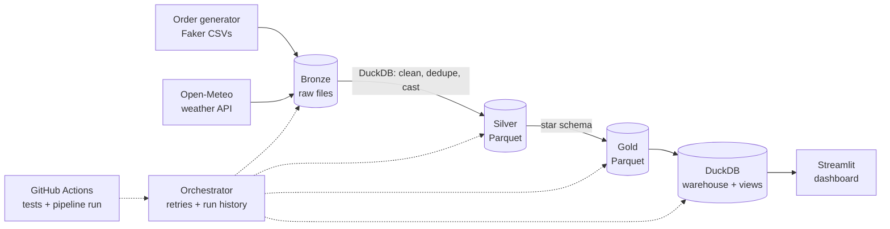
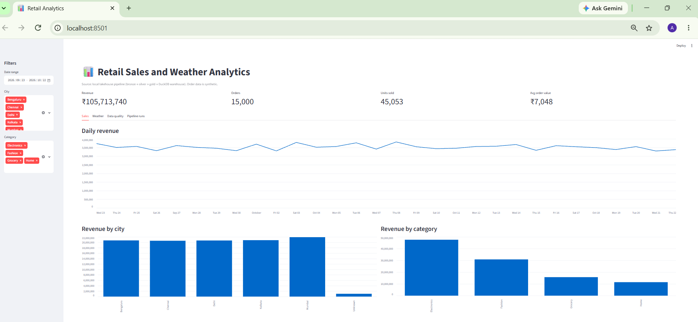
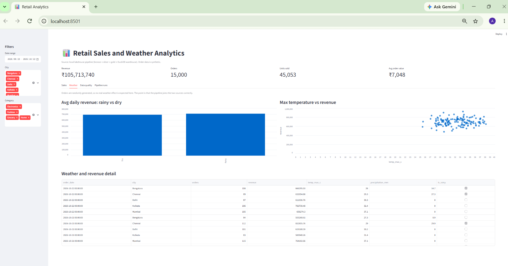

# Retail Sales and Weather Analytics Pipeline


An end-to-end data engineering project that ingests daily retail orders and
weather API data, cleans it in a **medallion architecture** (bronze, silver,
gold), models a **star schema**, loads a SQL warehouse, and serves a dashboard.
It is built entirely on free, local tools. Order data is synthetic.

## Architecture



| Layer | What happens |
|---|---|
| Bronze | Raw orders, products and weather JSON landed as received, partitioned by date. Re-runs skip files already landed |
| Silver | Duplicates removed, text standardized, types enforced, weather JSON flattened, 6 data quality checks |
| Gold | Star schema (`fact_orders`, 4 dimensions) plus a daily sales and weather summary, 6 reconciliation checks |
| Warehouse | Gold loaded transactionally into DuckDB with reporting views |
| Dashboard | Streamlit app with filters, KPIs, weather view and pipeline run history |

## Tech stack

Python, DuckDB, Parquet, SQL, Pandas, Streamlit, Open-Meteo REST API, pytest, GitHub Actions.

## Quick start (Windows PowerShell)

```powershell
git clone https://github.com/<your-username>/retail-de-pipeline.git
cd retail-de-pipeline
python -m venv .venv
.venv\Scripts\Activate.ps1
pip install -r requirements.txt

python -m data_generator.generate_data --days 30 --rows 500
python -m pipeline.run_pipeline          # ingest, silver, gold, warehouse
streamlit run dashboard/app.py           # open http://localhost:8501
python -m pytest -q                      # run the tests
```

## Screenshots




## Engineering practices

- **Idempotent**: every stage can be re-run without creating duplicates
- **Data quality gates**: the pipeline stops if a check fails
- **Orchestration**: step ordering, retries with backoff, fail-fast, run history table
- **Transactional warehouse load** with row-count reconciliation
- **Tests and CI**: unit tests plus a full offline pipeline run on every push
- **Observability**: per-step log files and a `pipeline_runs` table
- **Incremental loads**: silver keeps a state file (watermark plus a content hash per bronze partition) and only reprocesses new or changed days. Late or corrected files are detected by hash. A `--full-refresh` flag rebuilds everything.
## Design decisions and trade-offs

- **DuckDB instead of a cloud warehouse**: zero cost and no setup, and the SQL ports easily to Azure SQL or Synapse
- **Local files instead of ADLS**: the bronze/silver/gold layout is the same as in a cloud data lake
- **Windows Task Scheduler instead of Airflow**: fine for one daily job, and Airflow or Azure Data Factory would suit many dependent jobs
- **Full refresh of silver and gold**: simple and correct at this size, and incremental loads would be next at larger scale
- **Synthetic orders**: so no real-world business conclusions should be drawn from the dashboard

## Possible extensions

- Move storage to Azure Data Lake Storage Gen2 and orchestration to Azure Data Factory
- Incremental loads with a watermark
- Slowly changing dimension for customers
- dbt for the transformation layer

## Project structure

```
data_generator/   synthetic source data
ingestion/        bronze layer + config
transform/        silver and gold layers
warehouse/        DuckDB load
sql/              reporting views
pipeline/         orchestrator
dashboard/        Streamlit app
tests/            pytest suite
```